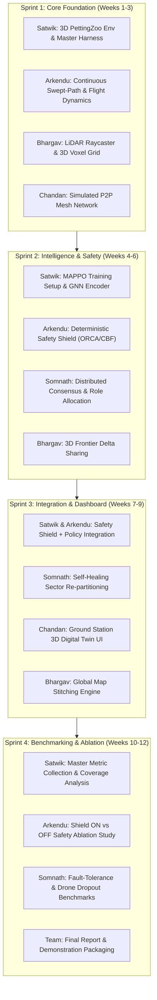

# SWARMDR / SwarmRL: System Architecture & Development Lifecycle

A comprehensive technical blueprint, module integration strategy, and 5-member work division plan for the autonomous disaster-response drone swarm system.

---

## 1. Unified System Architecture

The system integrates decentralized swarm coordination, dual-layer control (reinforcement learning + deterministic safety shielding), 3D volumetric mapping, and a ground station digital twin into a cohesive, decoupled architecture:

```
+-----------------------------------------------------------------------------------+
|                        TIER 1: GROUND STATION & DIGITAL TWIN                      |
|  - Operator Telemetry Dashboard (Streamlit / Three.js / WebGL)                    |
|  - Global Disaster Digital Twin (Aggregated 3D Point Cloud / Sparse Voxel Grid)   |
|  - Mission Planning, Dynamic Geofencing, Global Priority Broadcasts               |
|  - Telemetry Logging & Operator Override                                          |
+------------------------------------------^----------------------------------------+
                                           | Simulated Low-Bandwidth Telemetry (gRPC/MQTT)
+------------------------------------------v----------------------------------------+
|                   TIER 2: DECENTRALIZED SWARM COORDINATION LAYER                  |
|  - P2P Communication Mesh (Range-Constrained Ad-Hoc Topology)                     |
|  - Distributed Consensus Engine (Bayesian/Byzantine Voting on Target Validation) |
|  - Dynamic Task Allocation (Utility/Auction-based: Thermal vs Kit vs Relay)       |
|  - Self-Healing Manager (Heartbeat Monitor & Sector Re-partitioning)              |
+------------------------------------------^----------------------------------------+
                                           | Local State & Frontier Delta Exchange
+------------------------------------------v----------------------------------------+
|                      TIER 3: ONBOARD DRONE AGENT STACK                            |
|                                                                                   |
|  [Perception & SLAM]        [Learned Decision Layer]    [Deterministic Safety]    |
|  - Simulated LiDAR Rays     - MAPPO Policy (Shared)     - Velocity Obstacles/ORCA |
|  - Local 3D Occupancy Grid  - GNN / Attention Encoder   - Control Barrier Function|
|  - Multi-Sensor Fusion       - Frontier-based Explorer   - Swept-Path Continuous   |
|    (Thermal + Vision + Audio)- Action: Desired Velocity   Anti-Tunneling Filter   |
|               \                       |                       /                   |
|                \                      v                      /                    |
|                 +---> [SAFETY ARBITER / SHIELD] <-----------+                     |
|                                       |                                           |
|                                       v (Guaranteed Safe Action)                  |
|                         [ACTUATION & FLIGHT DYNAMICS]                             |
|                         - Bounded Acceleration & Inertial Limits                  |
|                         - Wind Gust Disturbances & Battery Drain Simulation       |
+-----------------------------------------------------------------------------------+
```

---

## 2. Technical Pillars & Integration Strategy

### Pillar 1: 3D Mapping & Digital Twin (`Bhargav-Kumar2007/SwarmRL`)
* **Local Representation:** Each drone maintains an onboard, lightweight $N \times N \times N$ sparse voxel occupancy grid derived from simulated 16-beam LiDAR raycasting.
* **Bandwidth Optimization:** Instead of passing dense point clouds over lossy mesh radios, drones broadcast only **Frontier Deltas** (bounding coordinates of newly discovered obstacles and free spaces) within their communication radius (`comm_radius`).
* **Ground Twin Aggregation:** When a drone enters base range or connects via a designated relay drone, it streams delta packets to the Ground Station to progressively render the master 3D Disaster Digital Twin.

### Pillar 2: Dual-Layer Control (MAPPO Policy + Deterministic Safety Shield)
* **Learned Guidance Layer (RL):** A Multi-Agent Proximal Policy Optimization (MAPPO) policy with Centralized Training and Decentralized Execution (CTDE). Drones observe local occupancy, battery levels, and neighbor vectors encoded via a Graph Neural Network / Attention layer to predict the optimal exploration velocity.
* **Deterministic Safety Layer:** Raw velocities from the neural network are intercepted by a deterministic safety shield (ORCA / Control Barrier Functions) onboard each drone. If an action risks breaching the minimum separation distance or collides with a swept-path barrier, the shield projects the velocity onto the nearest mathematically verified safe set. **Zero collisions are enforced by design.**

### Pillar 3: Distributed Swarm Intelligence & Resilience
* **Survivor Localization Voting:** Drones use a distributed voting protocol. If Drone A detects a heat signature (65% confidence) and Drone B registers an audio distress cue, they exchange confidence metrics over the P2P mesh. Once the combined Bayesian confidence crosses 85%, the survivor location is locked and prioritized.
* **Self-Healing Topology:** Heartbeat pings run locally across connected peers. If a drone crashes or depletes its battery, neighbors detect its absence within 3 intervals and execute dynamic Voronoi sector rebalancing to absorb the coverage gap without central operator intervention.

---

## 3. Work Division & Ownership Matrix (5 Members)

| Member | Domain & Modules | Specific Responsibilities | Core Deliverables |
| :--- | :--- | :--- | :--- |
| **Satwik Choudhury** | **System Architecture, PettingZoo Simulation & RL Logic** | - Master codebase architecture and module integration.<br>- Upgrade `swarm_env.py` to 3D continuous dynamics and obstacle environments.<br>- Implement MAPPO training pipeline using Ray RLlib / clean RL.<br>- Build GNN / Self-Attention neighbor observation encoder.<br>- Multi-agent reward shaping (coverage rewards, graded near-miss penalties, survivor rewards).<br>- Automated benchmarking harness & evaluation pipeline. | - Upgraded 3D PettingZoo Environment.<br>- Trained MAPPO policy checkpoints.<br>- Neural network model definitions (`models/mappo_gnn.py`).<br>- Master benchmark test suite. |
| **Arkendu Chatterjee** | **Flight Dynamics & Deterministic Safety Shield** | - Implement deterministic safety filter (ORCA / CBF / Potential Field).<br>- Implement continuous swept-path collision math (anti-tunneling).<br>- Model realistic physical flight dynamics: acceleration limits, inertia, drag, and battery depletion curves.<br>- Implement environmental wind gust vectors and turbulence disturbances.<br>- Safety ablation experiments (Shield ON vs. Shield OFF, near-miss tracking). | - `safety_shield.py` (ORCA/CBF projection engine).<br>- `flight_dynamics.py` (kinematics, battery, wind).<br>- Collision-prevention ablation report with safety metrics. |
| **Somnath Saha** | **Swarm Coordination, Consensus & Dynamic Task Allocation** | - Decentralized area exploration & frontier search algorithms.<br>- Distributed Bayesian / Byzantine voting protocol for survivor confirmation.<br>- Dynamic task allocation engine (assigning roles: thermal scanner, emergency kit transport, comms relay).<br>- Self-healing manager: heartbeat monitoring and Voronoi sector redistribution upon drone dropout. | - `consensus_engine.py` (voting protocols).<br>- `task_allocator.py` (role auctioning).<br>- `self_healing_manager.py` (dropout recovery). |
| **Bhargav Kumar** | **3D Mapping, Sensor Perception & Digital Twin** | - Port and integrate 3D mapping modules from `Bhargav-Kumar2007/SwarmRL`.<br>- Build multi-beam simulated LiDAR raycaster in the environment.<br>- Implement onboard sparse OctoMap / Voxel occupancy memory.<br>- Develop peer-to-peer frontier delta sharing and global map-stitching algorithm. | - `lidar_sensor.py` (raycasting engine).<br>- `occupancy_grid.py` (sparse 3D octree).<br>- 3D Digital Twin aggregation pipeline. |
| **Chandan Mondal** | **Ground Station UI, Comms Mesh & Telemetry Engine** | - Build Ground Station visualization dashboard (3D WebGL / Pygame / Streamlit).<br>- Simulate realistic P2P mesh network constraints (packet loss, latency, communication range drop).<br>- Implement telemetry protocols and message schemas (gRPC / MQTT / Protobuf).<br>- Log experimental metrics: coverage over time, time-to-first-victim, network overhead. | - Ground Station 3D viewer & telemetry dashboard.<br>- `comm_mesh.py` (lossy ad-hoc network simulator).<br>- Metrics logging & graph visualization suite. |

---

## 4. Phased Implementation Roadmap (12-Week Plan)



### Detailed Phase Milestones:
* **Weeks 1–3 (Core Foundation):**
  - Continuous 3D environment with static debris obstacles.
  - Multi-beam LiDAR raycasting returning distance vectors.
  - Flight dynamics with acceleration caps, battery drain, and wind gust disturbances.
  - Simulated lossy ad-hoc network channel with probabilistic packet drops.
* **Weeks 4–6 (Intelligence & Safety):**
  - MAPPO multi-agent policy training with curriculum learning for chaotic environments.
  - Onboard deterministic safety shield intercepting and filtering unsafe motor commands.
  - Distributed Bayesian voting state machine for survivor confidence verification.
  - Voxel compression and delta transmission across local links.
* **Weeks 7–9 (Integration & Interface):**
  - Full closed-loop simulation: policy decisions filtered by the safety shield in real time.
  - Real-time Ground Station UI rendering drone positions, active comms tethers, and synthesized 3D map.
  - Self-healing recovery triggered dynamically during mid-mission agent failures.
* **Weeks 10–12 (Evaluation & Academic Delivery):**
  - Collision rate, near-miss frequency, and minimum separation distance across 1,000 runs.
  - Area coverage speed and time-to-first-victim vs. baseline heuristic pathfinding.
  - Communication overhead evaluation under varying packet loss levels.

---

## 5. Future Scope (Physical Deployment & Hardware-in-the-Loop)

While the current project scope focuses strictly on high-fidelity simulation and algorithmic verification, the modular architecture is designed to support the following post-project transitions:

1. **Software-in-the-Loop (SITL) Simulation:**
   - Interfacing the onboard control stack with PX4 / ArduPilot autopilots running in Gazebo or AirSim environments.
2. **MAVLink / ROS 2 Hardware Bridges:**
   - Wrapping the trained ONNX policy and safety shield into ROS 2 nodes communicating via MAVLink to off-the-shelf companion computers (e.g., Raspberry Pi 5 / NVIDIA Jetson Orin Nano).
3. **Physical Radio Transceivers:**
   - Replacing simulated P2P mesh sockets with physical sub-GHz LoRa or DigiMesh hardware modules for field validation.
4. **Physical Flight Testing & Regulatory Clearance:**
   - Controlled outdoor flight tests with geofenced drone fleets adhering to civil aviation safety regulations.

---

## 6. Immediate Codebase Action Items

1. **Update `swarm_env.py`:**
   - Migrate observation and action spaces from 2D plane to 3D continuous bounds (`Box(shape=(3,))`).
   - Add static obstacle bounding boxes (buildings and debris).
2. **Create `flight_dynamics.py`:**
   - Move acceleration bounds, drag, and wind vectors into a dedicated kinematics engine.
3. **Create `safety_shield.py`:**
   - Build the velocity projection algorithm (swept-path collision detection + ORCA/potential field).
4. **Create `models/mappo_agent.py`:**
   - Initialize the policy and value network architectures with neighbor attention layers.
